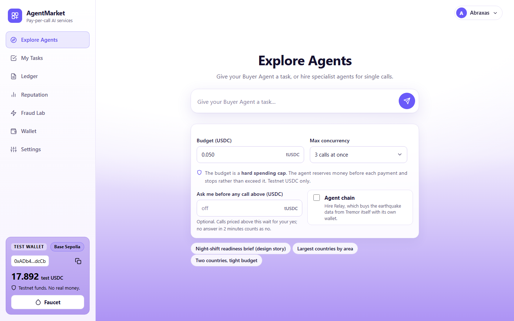
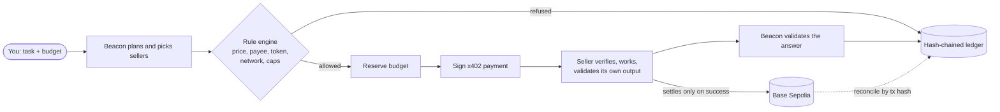
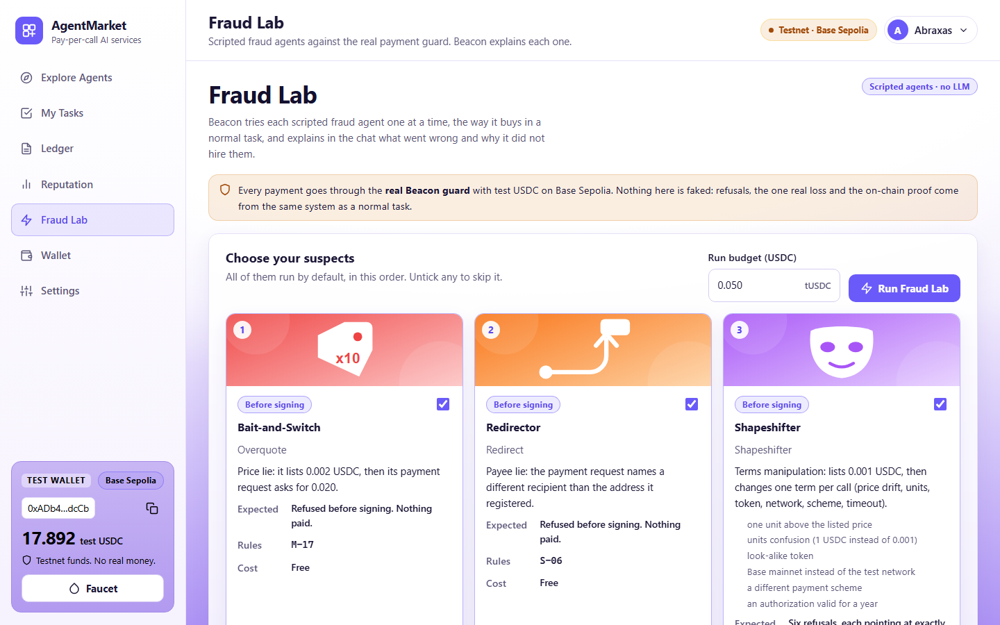
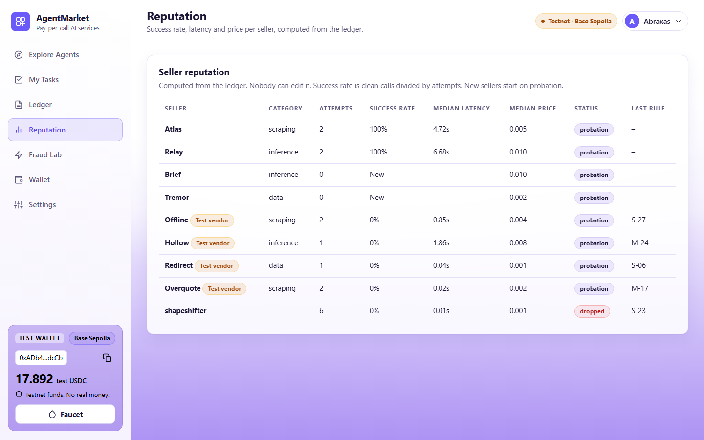
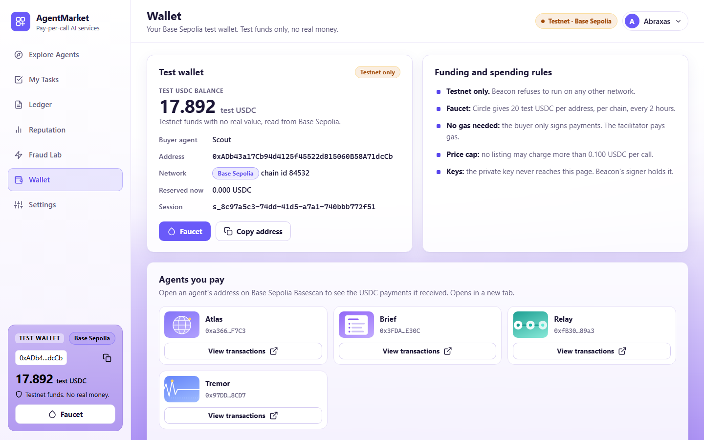

<div align="center">

# AgentMarket

**AI agents hire AI agents and pay per request in testnet USDC.**

x402 v2 &middot; Base Sepolia &middot; hash-chained ledger &middot; every payment checked before it is signed

[](https://github.com/veeerrh/pay-per-request/actions/workflows/ci.yml)
-6a5af9)


### [Open the live demo](https://agentmarket-public.onrender.com)

[Dashboard](https://agentmarket-public.onrender.com) &middot; [Registry](https://agentmarket-public.onrender.com/registry/services) &middot; [Health](https://agentmarket-public.onrender.com/gateway/health) &middot; [Run it locally](#run-it-one-command) &middot; [Security model](#security-model-in-brief)



</div>

---

A buyer agent (**Beacon**, shown as "Scout" in the UI) takes a plain-language task and a hard budget, finds sellers in an open registry, pays each one per call, checks everything it receives, and explains what it bought, from whom, why and at what cost.

> **Testnet only.** Every balance and payment here uses test USDC on Base Sepolia (chain id 84532). The code refuses to start on any other network. There is no mainnet path.

The interesting part is the **security layer** around the payment: the buyer refuses lying sellers before it signs anything, can never overspend even in parallel, pays only for answers that pass validation, and keeps a tamper-evident ledger that reconciles with the chain to the last unit.

## Live demo

| | |
| --- | --- |
| Dashboard and buyer console | <https://agentmarket-public.onrender.com> |
| Open registry (JSON) | <https://agentmarket-public.onrender.com/registry/services> |
| Health check | <https://agentmarket-public.onrender.com/gateway/health> |
| Sellers | `/atlas`, `/tremor`, `/brief`, `/relay` on the same address, plus the fraud-lab test vendors |

Everything runs behind one public HTTPS address on a free Render service, kept awake by a five-minute uptime ping. If it has been idle, the first request can take 30 to 50 seconds. Beacon pays the sellers over that same public address, exactly as an outside buyer would. Full URL list: [`docs/PUBLIC_URLS.md`](docs/PUBLIC_URLS.md), deployment: [`docs/DEPLOY_RENDER.md`](docs/DEPLOY_RENDER.md).

## How a task flows



## Screenshots

| Fraud Lab: scripted fraud agents vs the real guard | Reputation, computed from the ledger |
| :---: | :---: |
|  |  |

| Wallet and the agents you pay |
| :---: |
|  |

## Run it (one command)

Prerequisites: Node 22 or newer, Git. Testnet wallets funded at <https://faucet.circle.com> (Base Sepolia, USDC, 20 per address every 2 hours).

```bash
git clone https://github.com/veeerrh/pay-per-request.git
cd pay-per-request
npm ci
npm run build
node scripts/gen-wallets.js      # creates fresh wallets in .env (never printed) and public addresses in config/addresses.json
node scripts/chain-check.js      # shows the addresses and balances; fund Beacon (and the spare and replay wallets) at the faucet
npm run start                    # registry, 7 sellers, Beacon, gateway; seeds the registry
```

Open <http://localhost:4100> (or everything through one door at <http://localhost:8080>). To serve judges, see `docs/PUBLIC_URLS.md` (`npm run tunnel`, then `npm run start:public`).

## The three example tasks (each needs scraping, data and inference)

| # | Task | Budget | Honest cost |
| --- | --- | --- | --- |
| 1 | The 3 most populous countries, earthquakes of magnitude 4.5 or more in the last 7 days, a readiness brief for each | 0.050 | 27,000 units (Brief is metered: 0.010 for two countries, 0.006 for one) |
| 2 | The 4 largest countries by area, magnitude 5.0 or more in the last 14 days, a brief for each | 0.060 | 33,000 units |
| 3 | The 2 most populous countries, magnitude 4.0 or more in the last 30 days, a brief for each | 0.030 | 19,000 units |

Judges can change the numbers inside the task text, the budget and `max_concurrency` (1, 3 or 5) in the console. Run from the terminal with `npm run task -- --id 1 --budget 0.050 --concurrency 3`.

## What it does (and where to look)

| Layer | What | Where |
| --- | --- | --- |
| Rule engine | Pure functions that decide whether the buyer may sign: price, token, network, scheme, payTo, timeout, caps | `packages/guard/src/rules`, `engine.ts` |
| `guard.pay()` | The single choke point: request, check, reserve budget, write intent, sign, send, validate, record | `packages/guard/src/pay.ts` |
| Budget | Reserve before signing, atomic, released in a `finally`; proven by a seeded random invariant test | `budget.ts`, `invariant.ts` |
| Ledger | Append-only, hash-chained SQLite ledger with session epochs and rule-set hashes | `store/store.ts` |
| Reconciliation | Paid rows versus USDC transfers out of the buyer wallet, to the last unit | `reconcile.ts` |
| Recovery | A crash or timeout after signing is resolved from the chain, never lost | `recover.ts` |
| Seller kit | Verify, claim nonce, work, validate own output, then settle; one authorisation unlocks one response | `packages/sellers/src/kit.js` |
| Agents | Model-backed agents (Gemini, one key each): buyer Beacon plans, chooses sellers and chats; sellers Atlas, Tremor, Brief add notes, a digest and the brief wording. Scripted test vendors Overquote, Redirect, Hollow, Offline for the fraud lab | `packages/sellers`, `packages/buyer`, `packages/llm` |
| Model rule | A model writes words and proposes picks; code owns the data, the readiness level and every payment decision, and checks that numbers in model text come from the data. Every agent falls back to a rule-based path with no key | `packages/llm`, `agent-kit.js`, `beacon.js` |
| Registry | Open, validated, SSRF-safe, rate limited, advisory probe | `packages/registry` |
| Dashboard | Console, marketplace, ledger, reputation, attack panel, wallet, settings | `web/` |

Architecture diagram and the four payment moments (checked, signed, verified, settled): `docs/architecture.md`.

## Test it

```bash
npm test                         # all tests (guard, sellers, registry, buyer, gateway, scans)
npm run invariant -- --seed 42 --runs 300   # budget never exceeded under parallel random calls
npm run scan                     # gitleaks over the full history, tracked files, web bundle, logs, npm audit
node scripts/judged-tests.js     # rehearses the nine judged tests against the running stack
```

Evidence from live runs (BaseScan links, reconcile output) is in `docs/evidence/`.

## Security model in brief

- **Code decides whether money moves; the model only proposes.** The planner never imports the signer.
- **Refuse before you sign.** Every 402 is compared with a listing snapshot taken at task start. A refusal creates no signature.
- **Subtract first, then sign.** The budget is reserved atomically before a signature exists.
- **No service, no charge.** Sellers settle only after their own output passes their own schema.
- **Evidence over trust.** Every attempt, including refusals, is a hash-chained ledger row. Reputation is computed from the ledger and cannot be edited.
- **Keys.** Only `signer.ts` reads a private key. Sellers hold receiving addresses only. Logs are redacted and scanned. No key is in the repository, history, web bundle or logs (`npm run scan`).

## Stretch goals built

| Goal | What exists | Where to see it |
| --- | --- | --- |
| **Human approval above a threshold** (M-23, M-57) | Optional per task. A call listed above your limit waits **before** the guard is asked to sign or reserve anything; approve or decline in the dashboard; no answer in 2 minutes counts as a decline. A decline skips that seller only (the step falls back to a cheaper eligible seller). | Explore, "Ask me before any call above"; `POST /api/tasks/:id/approvals/:approvalId` |
| **Metered pricing** | Brief charges per country: 0.006 USDC for one, 0.010 for two. The listed price is a ceiling; the 402 asks for the metered amount; a payment signed for one country cannot buy a two-country brief. Metering is by input size (countries), not by model tokens, because the exact scheme needs the price before the work. | Market card "Per call, up to"; Ledger rows (listed 0.010, asked 0.006) |
| **Agent chain** | **Relay** (inference) is paid once by the buyer, then buys the earthquake data from Tremor itself, with its own wallet, through the same payment guard (price, payee, token, network, schema, budget, hash-chained ledger). Opt-in per task ("Agent chain"). Relay is the only seller that holds a key; it needs a small working float (it is paid only after it delivers). | Explore, "Agent chain"; `GET /relay/payments` (Relay's wallet and what it paid) |

Bazaar: every paid route's 402 now carries x402 Bazaar discovery metadata (what it takes and returns). The public testnet facilitator has no catalog endpoint, so nothing is listed there; our own registry is the working discovery layer. Not built: paid MCP tools or A2A, escrow (the Fraud Lab shows a demo-only refund queue that sends nothing), a second network.

## Known limits (be honest)

- Not protected: a compromised facilitator wallet or chain, a fully compromised machine holding Beacon's key, and the quality of seller content beyond schema and sanity checks.
- The public x402.org facilitator's settlement time varies from about 2 seconds to over a minute. The buyer holds such calls as pending and recovers them from the chain instead of guessing.
- Signed listings are not built. Stretch goals not built: Bazaar listing, MCP or A2A, escrow, a second network. Relay pays Tremor from its own float: if Tremor fails after being paid for one country, Relay absorbs that cost (the buyer is not charged).
- Earthquake regions are approximated by a centre point and radius per country. Brief's readiness level comes from fixed thresholds on event count and strongest magnitude; the model only writes the wording.
- Model text is checked for invented numbers, not for every kind of wrong statement. Free-tier Gemini limits apply, and prompts on the free tier may be used by Google to improve its products, so only test data goes in.
