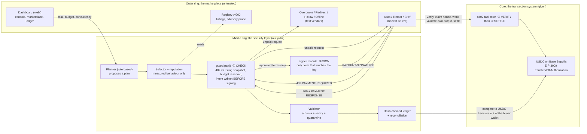

# Architecture: where a payment is checked, signed, verified and settled

Governing rule: **the model decides what to buy, plain code decides whether money moves.** The planner never imports the signer.

## The four moments

| Moment | Where it happens | What it guarantees |
| --- | --- | --- |
| ① Checked | `guard.pay()` and the rule engine, before anything is signed | Price, token, network, scheme, payTo and timeout all equal the listing snapshot. A refusal creates no signature |
| ② Signed | `signer.ts`, the single module that reads a private key | Only terms that passed ① are signed, once per request id, after the budget is reserved |
| ③ Verified | Seller middleware asks the facilitator to verify, then claims the nonce atomically | One authorisation unlocks one response (replays get an error and no free work) |
| ④ Settled | Seller settles only after its handler succeeded and its own output passed its own schema | No service, no charge. The facilitator submits the transfer and pays gas |

After the response: the validator checks schema and content, the ledger writes a hash-chained row, and reconciliation compares paid rows with on-chain transfers to the last unit.

## Processes and ports

Gateway 8080 (one public door) routes to Beacon 4100 (dashboard, buyer API, signer), Registry 4000, and seven sellers 4011 to 4024. Only Beacon receives a private key. Sellers hold a receiving address only.
